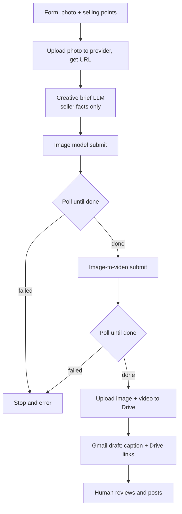

# Marketing Pack Generator

Upload one product photo and a few facts, get back a ready-to-review marketing pack for a Gulf/UAE audience: an enhanced hero image with an Arabic headline rendered on it, a short product video generated from that image, and a Gulf-Arabic ad caption. One n8n workflow, one form, one unified AI provider.

## The problem

A small business posting a new product has to shoot a hero image, produce a short video, and write ad copy, usually across three tools and a designer. That is slow and expensive for a single post. This packs the whole thing into one form submission and returns review-ready assets, with the human still in control of what actually gets published.

## What it does

- Takes a product photo plus seller-provided selling points through a form.
- Writes a creative brief from only the seller's facts (a hard no-fabrication constraint: no invented specs, prices, or awards).
- Generates an enhanced marketing image (product kept faithful, short Gulf-Arabic headline rendered on it).
- Generates a short image-to-video clip seeded by that enhanced image, so the product actually appears.
- Writes a Gulf/UAE Arabic caption with a call to action.
- Uploads both assets to Google Drive and drops the caption plus links into a Gmail draft for review. Nothing is auto-posted.

## Architecture

Both media steps are async: submit, then poll the prediction until it completes, with a shared failure node so the poll loop can never spin forever.

## Design choices

- **One provider, one key.** All generation runs through a single unified AI cloud (image, image-to-video, and the brief LLM), so there is one Bearer credential and one billing surface instead of three.
- **True image-to-video.** The clip is seeded by the enhanced product image, not generated from scratch, so it stays on-product.
- **No fabrication.** The brief prompt is constrained to the seller's own selling points only.
- **Draft and queue.** Output is a Gmail draft plus Drive files; a person reviews and posts. No automated publishing.

## Stack

n8n, a unified generative-AI cloud (image edit + image-to-video + chat LLM over one API), Google Drive, Gmail.

## Run it

1. Import `workflows/marketing-pack-generator.json`.
2. Bind three credentials by name: the AI cloud header-auth key, Google Drive, and Gmail. No key is committed; the review email is a placeholder to replace.
3. Open the form Test URL, submit a photo plus selling points, and review the resulting Gmail draft.

Model slugs and parameters are provider-current at build time; adjust if a call returns 4xx.

## Credits

Structure adapted from the n8n community templates Intuz (#9152) and Dr. Firas (#12462) on n8n.io, with the model choices and image-to-video path reworked for a single-provider setup.

## License

MIT, see [LICENSE](LICENSE).
